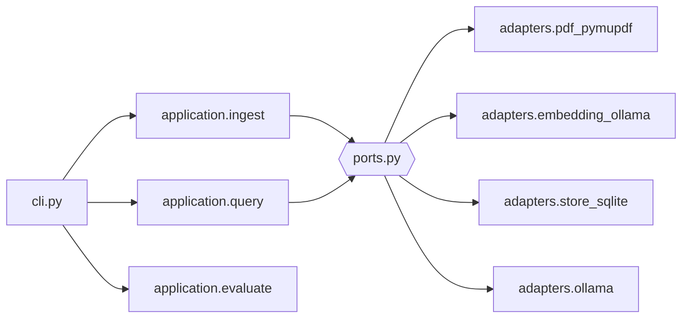

# Architecture

## Objective

`pagelens` retrieves evidence from PDFs when the evidence is text, a raster image, a
vector drawing rendered on a page, or a combination of these. A result is always grounded
to a source PDF, one-based page number, bounding box, and saved preview.

## Ingestion

```text
PDF -> page rendering -> overlapping regions -> image embeddings -> SQLite
                    \-> spatial native text --------------------/
```

PyMuPDF renders every page so vector artwork participates in visual search. Each page is
split into bounded, overlapping regions. Text blocks intersecting a region are attached to
that region. The configured Ollama multimodal embedding model embeds every region in a
shared text/image vector space. SQLite stores normalized vectors, text, provenance, and an
FTS5 index.

## Retrieval

Text and example images are independently embedded. Each candidate receives the maximum
cosine similarity across query vectors, which preserves distinct views rather than
averaging them into a synthetic prototype. Lexical matches provide a second retrieval
signal for exact model numbers. Results are grouped by region and ranked by fused score.

With `--verify`, the strongest crop and its complete PDF page are sent to an Ollama vision
model. The default `--evidence visual` policy requires the requested object to be visibly
depicted; nearby text may enrich metadata but cannot confirm a text-only page. The optional
`--evidence any` policy permits explicit text to confirm a result. The verifier returns
structured JSON and does not introduce candidates; it only confirms, rejects, and enriches
retrieved evidence. Each response identifies whether its decision used visual, textual, both,
or no evidence. The application rejects a `confirmed` result under visual-only policy when
the model reports text-only or no evidence.

## Evaluation

`testdata/ground-truth.json` defines page-level scenarios with an evidence policy, required
PDF/page pairs, and pairs that must not be confirmed. `pagelens evaluate` runs the same
retrieval and verification pipeline as a normal query. Without `--verify` it measures
candidate recall; with `--verify` it also checks false confirmations. This deliberately
separates retrieval quality from verifier behavior.

## Boundaries

The application layer depends on protocols for PDF extraction, embedding, persistence, and
verification. Adapters implement those protocols, allowing tests to use deterministic
fakes and a future Qdrant adapter to replace the initial SQLite/brute-force implementation.

The initial store is suitable for small and medium local collections. Approximate nearest
neighbour indexing, OCR engines, layout detection, and learned reranking are explicit
follow-up capabilities rather than hidden requirements.


## Component map



`domain/` holds the value types (`SearchResult`, `Verification`, `BoundingBox`); nothing in
`application/` imports an adapter.
